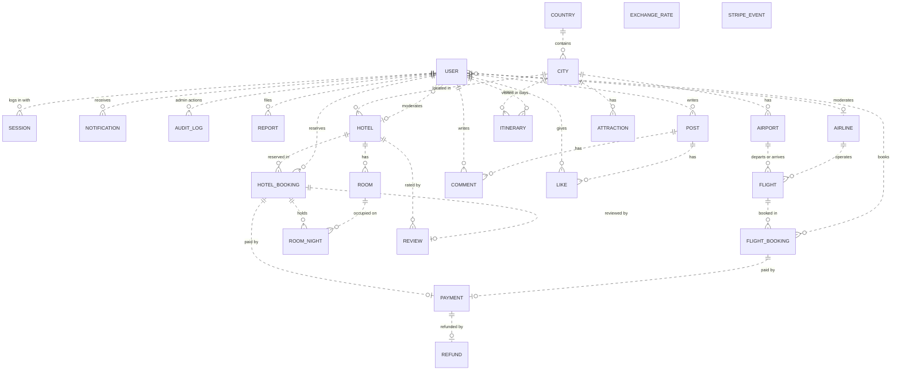
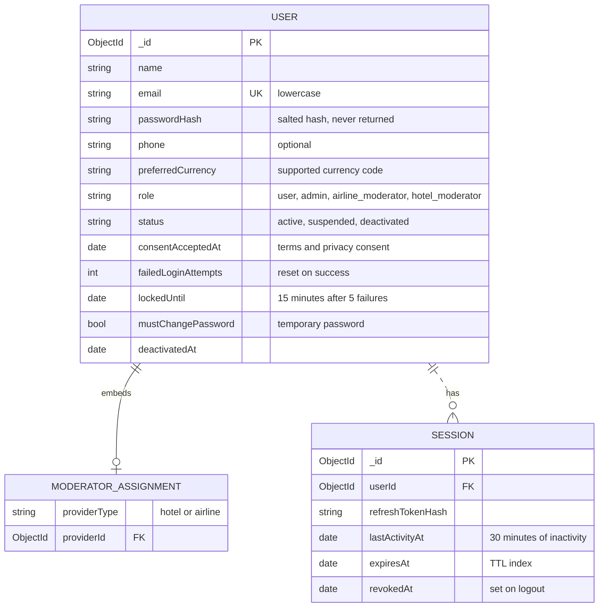
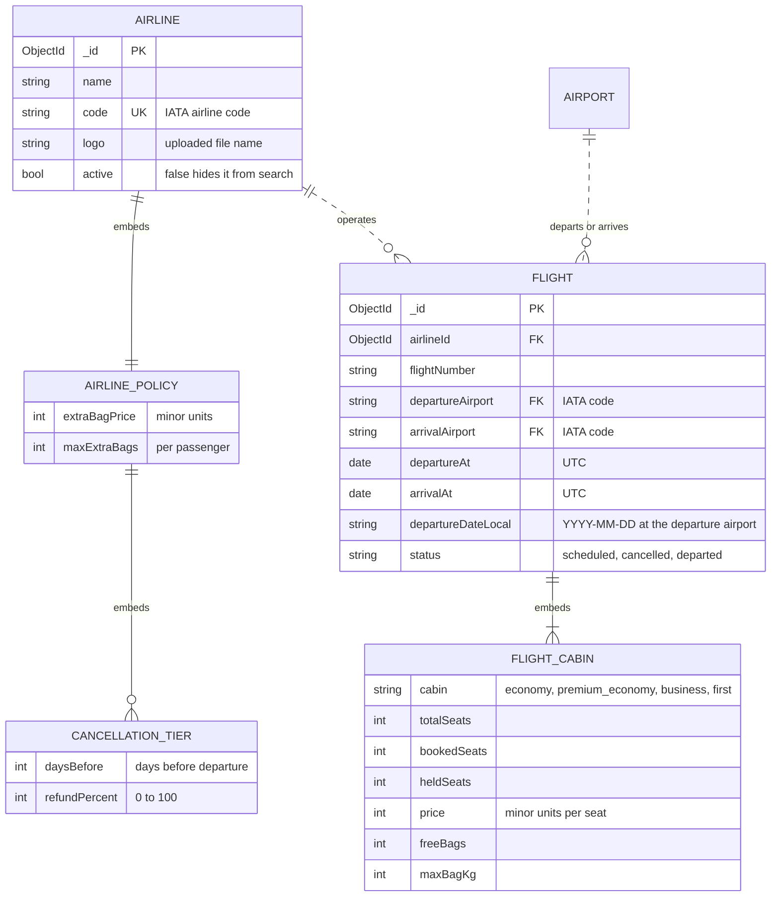
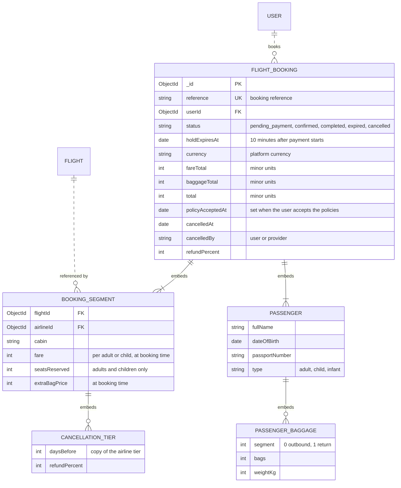
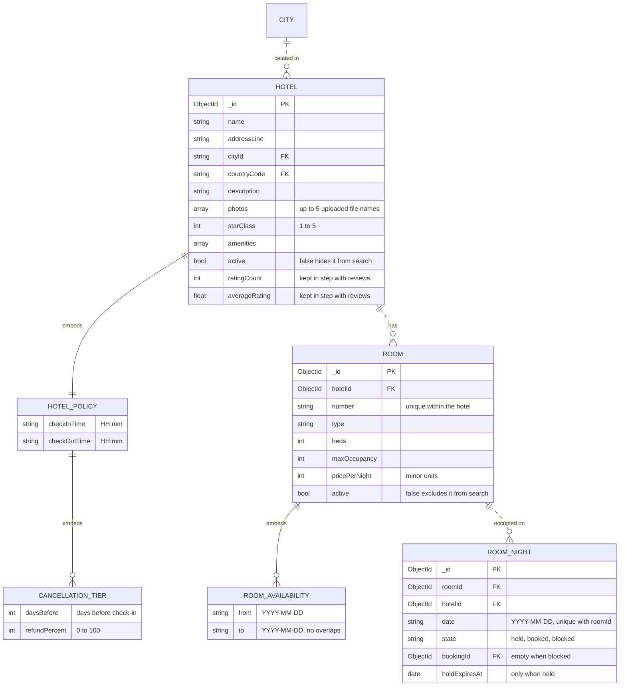
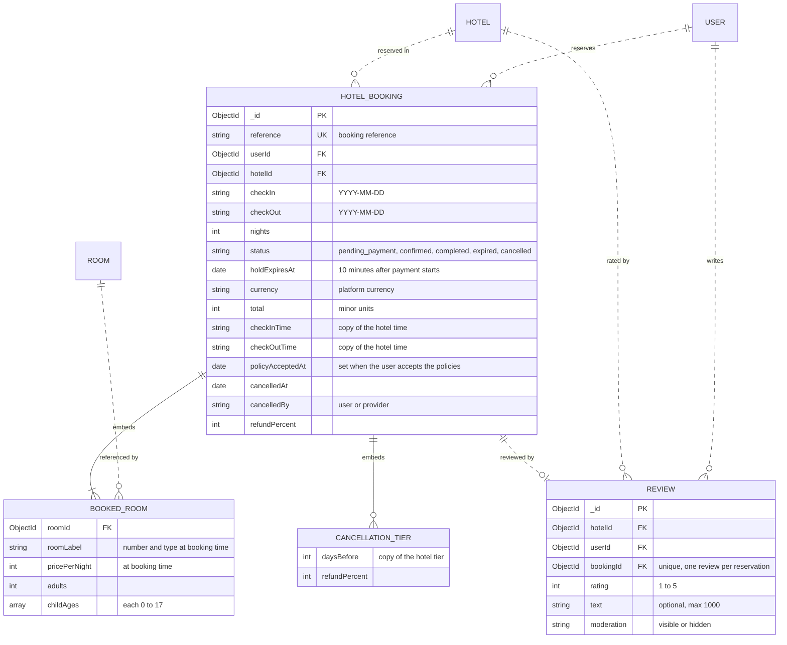
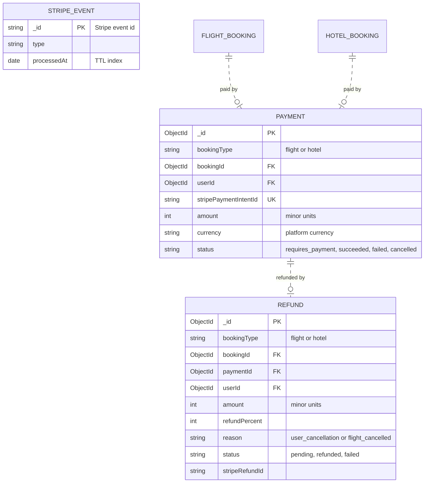
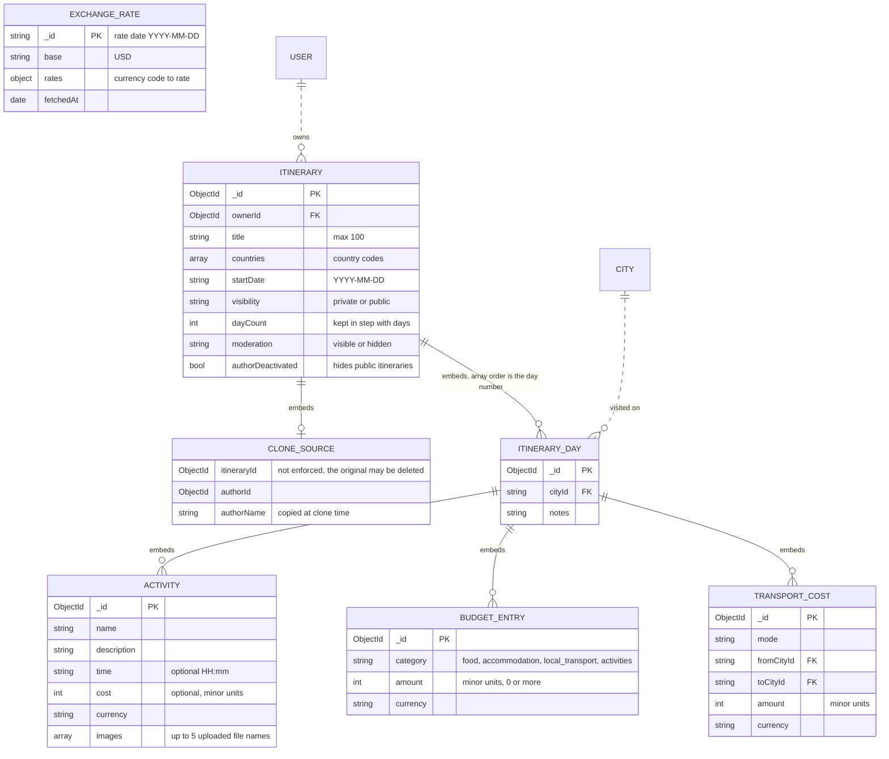
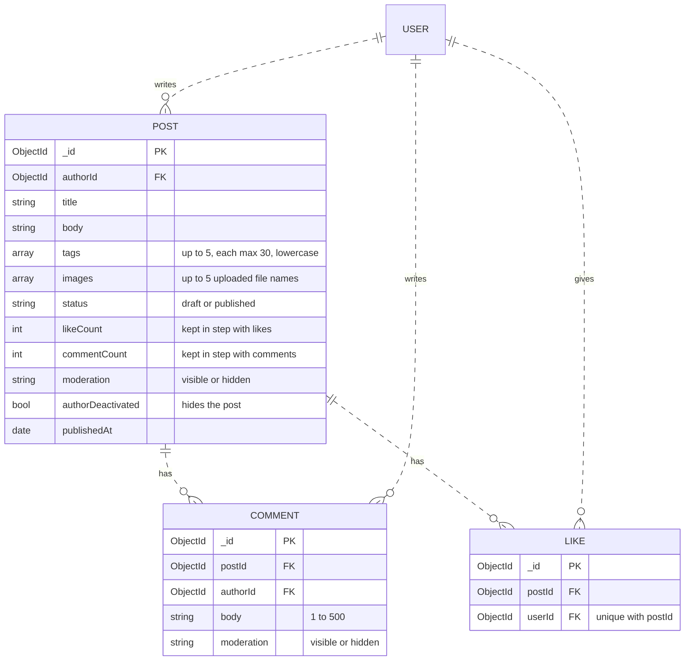
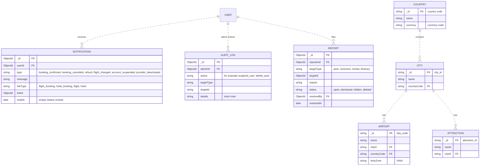

# Travel Planning and Booking Platform — Specification

Source of truth: the project description (`docs/requirements/`) and the official requirements workbook. If this file disagrees with them, they win. Exact business rules, limits and acceptance criteria are in the workbook.

The project description was revised on 2 Nov 2026 (the changes are highlighted in yellow in the PDF in `docs/requirements/`). This file follows the revised version.

## Problem

Travelers need one platform to search and book flights and hotels, plan day-by-day itineraries with budgets, and share travel content. Airlines and hotels need to manage their inventory and policies, and administrators need to supervise accounts, bookings and community content.

## Users

- Guest: unauthenticated visitor. Searches flights and hotels, browses public blog posts and itineraries.
- Registered user: books flights and hotels, manages bookings, creates itineraries and budgets, publishes or clones public itineraries, writes blog posts, comments, likes, reviews eligible hotel stays, reports content.
- Administrator (seeded): manages accounts, creates moderators, suspends and reactivates users, inspects bookings, moderates reported content, reviews audit logs.
- Airline moderator: manages exactly one assigned airline (profile, flights, cabins, prices, baggage rules, cancellation policies, bookings).
- Hotel moderator: manages exactly one assigned hotel (profile, rooms, availability, prices, policies, reservations).
- System services: payment confirmation, inventory-hold expiry, notifications, exchange rates, booking-state updates, audit logging.

## Scope by module

Requirement IDs are listed in the workbook. The mandatory/bonus split is also defined there.

| Module                      | ID prefix | Covers                                                                                                                                                                                                                     |
| --------------------------- | --------- | -------------------------------------------------------------------------------------------------------------------------------------------------------------------------------------------------------------------------- |
| Accounts and administration | ACC       | Registration, login with lockout, logout and session expiry, password change, profile, own-account deactivation, moderator accounts, account management, hotel and airline deactivation, admin booking list, admin seeding |
| Flights                     | FLT       | Airline profile, airports, flights, cabins, baggage and cancellation policies, search, filters, booking, seat hold, cancellation, passenger lists                                                                          |
| Hotels                      | HTL       | Hotel profile, rooms, availability, policies, search, multi-room reservation, room hold, cancellation, reviews                                                                                                             |
| Payments and policies       | PAY       | Stripe payment (test mode), policy acceptance, refunds, single platform currency                                                                                                                                           |
| Itineraries                 | ITN       | Itineraries, ordered days, city groups, activities, images, budgets, transport costs, currency conversion, visibility, search and clone                                                                                    |
| Blog                        | BLG       | Posts, comments, likes, tags, search, images, author pages                                                                                                                                                                 |
| Cross-cutting               | GEN       | Notifications, validation messages, pagination, time zones, audit log, image uploads, reporting and moderation, booking lifecycle, reference-data seeding, backend enforcement and password hashing                        |

Optional (bonus) features are marked Optional in the description: email verification and email password recovery (ACC-02, ACC-07), flight change and seat selection (FLT-27, FLT-28), hotel replies to reviews (HTL-26), attaching bookings to itineraries and PDF export (ITN-27, ITN-28), attaching itineraries to posts (BLG-13), email notifications, admin analytics and favourites.

## API contract

Base path `/api`. The full endpoint table is section 8 of the project description. Route groups:

| Group                       | Base routes                                                                   |
| --------------------------- | ----------------------------------------------------------------------------- |
| Authentication and accounts | `/api/auth/*`, `/api/users/me`                                                |
| Administration              | `/api/admin/*`                                                                |
| Airlines and flights        | `/api/airlines`, `/api/airports`, `/api/flights`                              |
| Flight bookings             | `/api/flight-bookings`                                                        |
| Hotels and rooms            | `/api/hotels`                                                                 |
| Hotel bookings and reviews  | `/api/hotel-bookings`, `/api/reviews`                                         |
| Payments and refunds        | `/api/payments`, `/api/refunds`, `/api/bookings/:type/:id/policies`           |
| Itineraries                 | `/api/itineraries`, `/api/activities`, `/api/budgets`, `/api/transport-costs` |
| Blog                        | `/api/posts`, `/api/comments`, `/api/tags`, `/api/authors`                    |

Provider status (ACC-15): `PATCH /api/admin/providers/:type/:id/deactivate` and `PATCH /api/admin/providers/:type/:id/reactivate`, where `:type` is `hotel` or `airline`. Deactivating a provider is separate from suspending its moderator account. A deactivated hotel or airline is hidden from search and cannot be booked, while its existing Confirmed bookings remain valid. Affected parties receive an in-app notification.

Swagger UI is served at `/api/docs`. Log in with `POST /api/auth/login` in Swagger: the browser then keeps the `httpOnly` cookies and sends them with every later request, so no token is ever pasted.

### Response conventions

- A successful response is the resource itself, with no wrapper object.
- Lists are paginated with `?page=1&limit=10` (GEN-05): page size 10 by default, at most 50, and `page` at most 10,000 (a page after the last is an empty page). `skip` is computed by the server: a client that sends it, or any other parameter a list does not have, gets a 400. A list response is `{ "items": [...], "meta": { "page", "limit", "total", "totalPages" } }`, and an empty result is `"items": []` (GEN-04).
- Every error has the same body: `{ "statusCode", "error", "message", "errors"?, "path", "timestamp" }`. `errors` appears only when validation fails (400) and lists `{ "field", "messages" }` for each invalid field (GEN-02), for example:

```json
{
  "statusCode": 400,
  "error": "Bad Request",
  "message": "Validation failed",
  "errors": [{ "field": "email", "messages": ["email must be an email"] }],
  "path": "/api/auth/register",
  "timestamp": "2026-11-05T11:00:00.000Z"
}
```

- Status codes: 400 invalid input, 401 not logged in, 403 wrong role or not the owner, 404 not found, 409 conflict such as a duplicate email, 413 image larger than 5 MB, 415 image that is not a JPG or PNG.
- Roles are `user`, `admin`, `airline_moderator` and `hotel_moderator`. A guest has no role. Every route requires login unless it is marked public.

## Validation and security

- Required fields, types and enums are validated by DTOs. Unknown properties are rejected.
- The client cannot set role, status, prices, booking reference, owner or payment state.
- Authentication uses a secure `httpOnly` cookie, never localStorage or sessionStorage.
- Two cookies (ACC-19): `access_token` (valid `ACCESS_TOKEN_MINUTES`, sent to every path, so the frontend's `proxy.ts` can read it on page requests) and `refresh_token` (valid `SESSION_INACTIVITY_MINUTES`, sent only to `/api/auth`). Both are `httpOnly`, `Secure` and `SameSite=Lax` by default. Logging in or refreshing issues new tokens. Logging out clears both cookies and revokes the refresh token on the server (ACC-06). A session with no authenticated request for 30 minutes expires. The frontend sends requests with `credentials: 'include'` and learns the current user from `GET /api/auth/me`.
- Images (GEN-08): only JPG and PNG, recognised by the first bytes of the file and not by its name or declared type; at most 5 MB each; at most 5 per post, activity or hotel and 1 logo per airline. A file is stored under a random name in `backend/uploads/` and served to anyone at `/api/uploads/<file>`. A request outside these limits is rejected with 413 (too large), 415 (not a JPG or PNG) or 400 (too many, or no file).
- Role checks and ownership checks happen on the backend. Moderators are limited to their assigned provider.
- Passwords are hashed. Account emails are unique.
- A booking is confirmed only after successful payment verification through the Stripe webhook.
- Booking and hold logic is safe under concurrent requests. Holds expire and release inventory.
- Policy acceptance is stored with a timestamp.

## MVC and module boundary

- Controller: HTTP concerns only.
- Service: business logic and database operations.
- Mongoose schema/model: persistence.
- DTO: validation.
- Frontend calls the API and never accesses MongoDB directly.
- One feature module per area, listed in the table below.

### Backend modules

Each module lives in `backend/src/<module>/` and holds its own controller, service, `models/` and `dto/`. Modules start empty and are filled in by the feature that needs them.

| Module            | Responsibility                                                                                                    | Base routes                                                                   |
| ----------------- | ----------------------------------------------------------------------------------------------------------------- | ----------------------------------------------------------------------------- |
| `auth`            | Registration, login with lockout, logout, cookie tokens, change password, current user                            | `/api/auth/*`                                                                 |
| `users`           | Own profile and own-account deactivation                                                                          | `/api/users/me`                                                               |
| `admin`           | Account management, moderator accounts, provider activation, admin booking list, report handling, audit log views | `/api/admin/*`                                                                |
| `flights`         | Airlines with their policies, flights, cabins, flight search, passenger list and CSV export                       | `/api/airlines`, `/api/flights`                                               |
| `flight-bookings` | Seat holds, flight bookings, cancellation, PDF e-ticket                                                           | `/api/flight-bookings`                                                        |
| `hotels`          | Hotels, rooms, availability, policies, hotel search                                                               | `/api/hotels`                                                                 |
| `hotel-bookings`  | Room holds, reservations, cancellation, hotel reviews                                                             | `/api/hotel-bookings`, `/api/reviews`                                         |
| `payments`        | Stripe payments and webhook, refunds, policy display and acceptance                                               | `/api/payments`, `/api/refunds`, `/api/bookings/:type/:id/policies`           |
| `itineraries`     | Itineraries, days, activities, budgets, transport costs, clone and public search                                  | `/api/itineraries`, `/api/activities`, `/api/budgets`, `/api/transport-costs` |
| `blog`            | Posts, comments, likes, tags, author pages                                                                        | `/api/posts`, `/api/comments`, `/api/tags`, `/api/authors`                    |
| `notifications`   | In-app notifications (GEN-01)                                                                                     | to be defined                                                                 |
| `audit`           | Administrative audit records (GEN-07)                                                                             | used by `admin`                                                               |
| `exchange-rates`  | FXRatesAPI client, daily cached rates, conversion, supported currencies (ITN-18)                                  | to be defined                                                                 |
| `uploads`         | Image upload validation, storage and serving (GEN-08)                                                             | used by other modules; serves `/api/uploads/<file>`                           |
| `reference`       | Seeded, read-only countries, cities, airports and attractions (GEN-12, FLT-02)                                    | `/api/airports`                                                               |
| `reports`         | Content reports from users (GEN-09); admins handle them through `admin` (GEN-10)                                  | to be defined                                                                 |

Code shared by several modules (the role enum, guards, decorators, pipes, the exception filter and the pagination DTOs) lives in `backend/src/common/`, not in a feature module.

## Reference data

Countries, cities, airports and attractions are seeded from the official reference datasets. Records and identifiers must match the datasets, because they are used in the final evaluation. The seed script is idempotent and creates the admin account from environment variables. It loads whatever rows the CSV files contain (8 each today) and does not hard-code any record.

Run the seed from `backend/` with `npm run seed`. `npm run seed -- --dry-run` does every check and shows what would change, but writes nothing. The seed first checks the four files (unique ids, every city has a country, every airport has a city of the same country, every attraction has a city) and stops before writing anything if a row is wrong. It then adds missing records and updates changed ones, and never deletes. It creates the administrator from `ADMIN_EMAIL` and `ADMIN_PASSWORD` in `backend/.env` only if no account with that email exists, so an existing administrator and their password stay unchanged. Only the team leader runs it against the shared database.

Each airport has its IANA time zone (`time_zone` in `airports.csv`), used to show flight times in local time (GEN-06) and to read search dates as local dates (FLT-11). The supported currencies are the currency codes listed in `countries.csv` (GEN-12); these are the currencies a user can choose as preferred currency (ACC-09) and convert itinerary budgets into (ITN-18).

## Out of scope

- Cloud deployment (optional bonus)
- Optional features above, until all mandatory requirements are done and the team agrees

## Data model diagram

This is the design of the MongoDB collections. It follows section 5 of the project description and was checked against every mandatory requirement in the workbook. In each diagram a solid line labelled "embeds" means the data is stored inside its parent document, and a dashed line means a reference by id. Boxes joined by a solid line are not collections of their own.

### Conventions

- Ids are ObjectIds, except country, city, airport and attraction, which use the official ids from the reference datasets as `_id`.
- Every collection also has `createdAt` and `updatedAt` (Mongoose timestamps). They are left out of the diagrams.
- Money is stored as whole minor units (cents) plus a currency code. Bookings, payments and refunds use the single platform currency (PAY-04). Itinerary entries keep their own currency and are converted when read (ITN-18).
- Moments in time are UTC dates. Calendar dates (hotel stays, itinerary start date) are `YYYY-MM-DD` strings. A flight also stores `departureDateLocal`, the date at the departure airport, for search and for the duplicate flight rule.
- Enums are stored as strings.
- A booking copies the prices and the cancellation tiers it was made under, so later edits never change an existing booking (FLT-05, HTL-05) and a refund always follows the policy the user accepted (PAY-02).
- Counters (`heldSeats`, `bookedSeats`, `ratingCount`, `averageRating`, `likeCount`, `commentCount`, `dayCount`) are caches that the service keeps in step. They can always be recomputed from the documents they summarise.
- Uploaded images are stored as file names; the files live in `UPLOADS_DIR` (GEN-08).

### Overview



### Collections by module

| Module            | Collections                                      |
| ----------------- | ------------------------------------------------ |
| `auth`            | `sessions`                                       |
| `users`           | `users`                                          |
| `flights`         | `airlines`, `flights`                            |
| `flight-bookings` | `flight_bookings`                                |
| `hotels`          | `hotels`, `rooms`, `room_nights`                 |
| `hotel-bookings`  | `hotel_bookings`, `reviews`                      |
| `payments`        | `payments`, `refunds`, `stripe_events`           |
| `itineraries`     | `itineraries`                                    |
| `exchange-rates`  | `exchange_rates`                                 |
| `blog`            | `posts`, `comments`, `likes`                     |
| `notifications`   | `notifications`                                  |
| `audit`           | `audit_logs`                                     |
| `reports`         | `reports`                                        |
| `reference`       | `countries`, `cities`, `airports`, `attractions` |

The `admin` and `uploads` modules have no collections of their own.

### Accounts and roles



- The moderator assignment is embedded in the user, because a moderator has exactly one provider and the ownership check reads it on every request (ACC-13).
- Sessions are separate. One user has many, each holds the hash of a refresh token so logout can revoke it (ACC-06), and a TTL index deletes expired ones.
- `status` covers suspension (ACC-15, ACC-16) and own-account deactivation (ACC-12). A deactivated user is shown as "Deleted user" on comments and reviews.
- Indexes: unique `email`; `sessions.userId`; TTL on `sessions.expiresAt`; `users.assignment.providerId`.

### Flights



- The cabins (at most 4) are embedded in the flight, so the seat counters live in the same document and one conditional update reserves seats only if enough remain (FLT-22). Available seats are `totalSeats - bookedSeats - heldSeats`.
- `departureAt` and `arrivalAt` are UTC. The airport time zones (see Reference data) are used to show local times (GEN-06). `departureDateLocal` supports search by local date (FLT-11) and the rule that an airline cannot repeat a flight number on the same departure date (FLT-03).
- Only `scheduled` flights are searchable, editable or bookable (FLT-30). A flight becomes `departed` once its departure time has passed.
- Indexes: unique `airlines.code`; unique (`airlineId`, `flightNumber`, `departureDateLocal`); (`departureAirport`, `arrivalAirport`, `departureDateLocal`, `status`).

### Flight bookings



- A round trip is one booking with two embedded segments, one reference and one payment (FLT-12). Infants are stored as passengers but occupy no seat, so `seatsReserved` counts adults and children only.
- Extra baggage is stored per passenger and per segment, because the two directions can be different airlines with different bag prices (FLT-08, FLT-19).
- A segment stores the flight id, so flight times are always read from the flight. A schedule change (FLT-05) is visible in every booking without copying. The cancellation tiers and the extra bag price are copied, and a round trip is refunded using the first segment's tiers.
- Indexes: unique `reference`; (`userId`, `status`); `segments.flightId`; (`status`, `holdExpiresAt`) for the hold-expiry job.

### Hotels



- The policy and the date ranges when a room is bookable are embedded, because each belongs to exactly one hotel or room (HTL-04, HTL-09, HTL-10).
- `room_nights` has one document per room per night, with the state `held`, `booked` or `blocked`. The unique index on (`roomId`, `date`) means two people can never hold the same night. Blocking a date range is rejected when any of its nights is already taken (HTL-06). The moderator's room status view (HTL-08) reads this collection.
- Booking several rooms must be all-or-nothing (HTL-18), so it uses a MongoDB transaction (an Atlas free cluster is a three-node replica set); if a transaction turns out to be unavailable, the nights already inserted are deleted when one insert fails. Held nights whose `holdExpiresAt` has passed are ignored by every query and removed before a new hold is inserted.
- Indexes: unique (`hotelId`, `number`); unique (`roomId`, `date`); (`hotelId`, `date`); (`cityId`, `active`).

### Hotel bookings and reviews



- One reservation embeds all its rooms, with the price and the guests of each (HTL-16), plus a copy of the cancellation tiers and the check-in and check-out times.
- Reviews are a separate collection because they are listed and paginated on their own and can be edited or deleted. The unique `bookingId` enforces one review per reservation (HTL-23). The hotel's `ratingCount` and `averageRating` are recalculated whenever a review is added, edited or deleted.
- A confirmed reservation becomes `completed` once its check-out date has passed.
- Indexes: unique `reference`; (`userId`, `status`); (`hotelId`, `status`); (`status`, `holdExpiresAt`); reviews (`hotelId`, `createdAt` descending); unique `reviews.bookingId`.

### Payments



- A payment stores only the Stripe payment id, amount, currency and status (PAY-01). A booking has one payment, and a retry reuses the same payment intent.
- A booking has at most one refund, because only whole cancellations exist (FLT-26, HTL-21). Its status is shown on the booking details (PAY-03).
- `stripe_events` stores the id of every processed webhook event. When Stripe sends the same event again, the id already exists and the handler ignores it.
- Indexes: unique `stripePaymentIntentId`; unique (`bookingType`, `bookingId`) on `payments` and on `refunds`; TTL on `stripe_events.processedAt`.

### Itineraries



- Everything under an itinerary is embedded in one document. It belongs to one owner, is bounded (at most 60 days, ITN-05) and is always loaded together.
- The day number is the position in the `days` array, so moving, deleting and renumbering days is one array update (ITN-07, ITN-08). Dates, city groups and budget totals are computed when read and never stored (ITN-09, ITN-14).
- Cloning copies the document and makes the clone private (ITN-21). `cloneSource` keeps the original author's name, so deleting the original leaves clones untouched (ITN-01).
- `exchange_rates` has one document per day, fetched once a day. The latest is used, and the last cached one when the API is unavailable (ITN-18).
- Indexes: (`ownerId`, `updatedAt`); (`visibility`, `moderation`, `authorDeactivated`, `dayCount`); text on `title`; `countries`; `days.cityId`.

### Community



- Tags are a list of strings inside the post. A separate tag collection would hold nothing but the name. Tag search and the tag page use an index on that list (BLG-08).
- Likes and comments are separate because they are unbounded. The unique (`postId`, `userId`) index on likes enforces "like once" (BLG-06).
- Search results are ordered by likes plus comments, newest first (BLG-09), computed from the two counters. Searching by author name first finds the users by name and then their posts, so no name is copied into the post.
- Indexes: (`status`, `moderation`, `publishedAt`); `tags`; text on `title`; comments (`postId`, `createdAt`); unique likes (`postId`, `userId`).

### Platform services and reference data



- A notification is unread while `readAt` is empty (GEN-01). The audit log is append-only (GEN-07). A report is unique per (`reporterId`, `targetType`, `targetId`), which enforces "at most once per item" (GEN-09). Hidden content stays visible to its author and to admins (GEN-10) through the `moderation` field on posts, comments, reviews and itineraries.
- The four reference collections keep the official ids, so the seed can run more than once without creating duplicates (GEN-12).
- The supported currencies are the distinct `currency` values in `countries`, so they have no collection of their own.
- Indexes: notifications (`userId`, `readAt`, `createdAt`); unique `reports` (`reporterId`, `targetType`, `targetId`); `reports.status`.

### Holds, concurrency and time-based changes

- Flight seats: one conditional update on the flight document reserves the seats, so concurrent requests can never book more seats than exist (FLT-22).
- Hotel rooms: the unique (`roomId`, `date`) index decides who gets a night, and a multi-room request is one transaction (HTL-18).
- Hold expiry: a scheduled job (`@nestjs/schedule`) finds `pending_payment` bookings whose `holdExpiresAt` has passed, sets them to `expired` with an update that only matches if they are still `pending_payment`, and then releases the seats or nights. The payment webhook confirms a booking with the same condition, so a booking cannot be both confirmed and released.
- The same job moves confirmed hotel reservations to `completed` after check-out and flights to `departed` after the departure time (HTL-23, FLT-30).
- Webhooks: the Stripe event id in `stripe_events` makes a repeated event harmless.
- If a cached counter ever disagrees with the documents it summarises, it is recomputed from them.

### Not modelled yet (optional features)

Each of these can be added later without changing the collections above: favourites (BON-02, a new collection), hotel replies to reviews (HTL-26, a field on the review), seat selection (FLT-28, seat numbers on the cabin and the segment), email verification and password reset tokens (ACC-02, ACC-07, a new collection), bookings linked to itinerary days (ITN-27, a field on the day) and an itinerary attached to a post (BLG-13, a field on the post).

## Milestones

- Milestone 1, backend and API: deadline 20/11. Evaluated through Swagger UI.
- Milestone 2, frontend and integration: deadline 11/12.

## Work organization

- Every member contributes to every part of the project.
- One short-lived branch per requirement or issue: `feature/<REQ-ID>-<description>`, from the latest `develop`.
- Pull requests go into `develop` and are approved by the team leader or the second reviewer.
- Reference requirement IDs in issues, branches, commits, PRs and Swagger docs.

## Definition of Done

- Follows this specification, `AGENTS.md` and the requirement's acceptance criteria.
- Relevant tests and lint pass.
- Swagger reflects API changes.
- Authorization and validation are enforced on the backend.
- Diff is reviewed.
- AI usage is logged in `AI_PROMPTS.txt`.
- PR passes CI and the required review.
